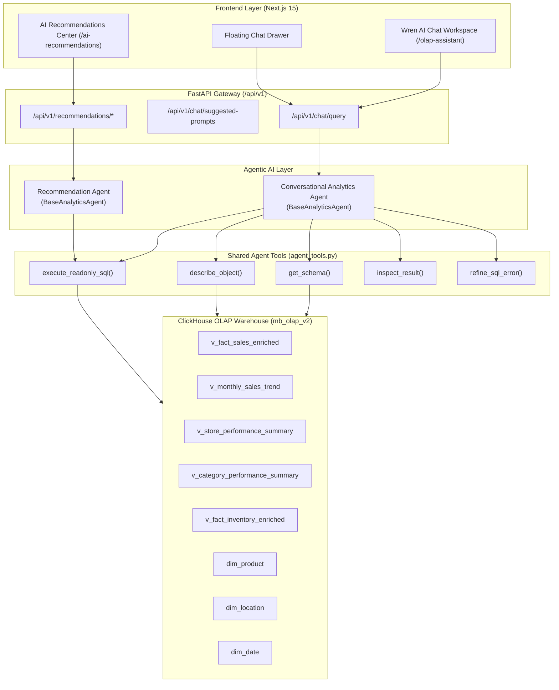
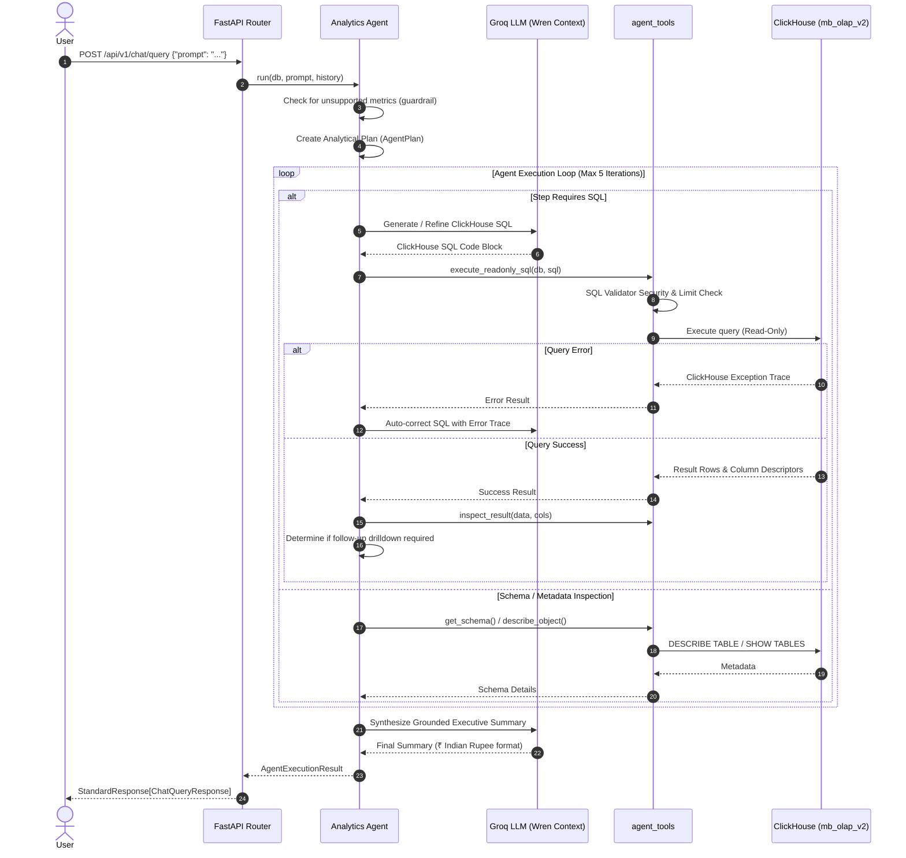

# ClickHouse Agentic AI System Architecture & Reference Guide

## 1. System Architecture

The M Baazar OLAP v2 analytics platform incorporates a modern, agentic AI architecture designed to query and reason over large-scale retail datasets stored in ClickHouse (`mb_olap_v2`).



---

## 2. Agent Workflow

Both analytical agents inherit from `BaseAnalyticsAgent` and follow an iterative execution loop:



---

## 3. Available Agent Tools

| Tool Name | Module | Purpose | Security Safeguards |
| :--- | :--- | :--- | :--- |
| `get_schema(db)` | [`agent_tools.py`](file:///d:/mb-olap-v2/backend/app/services/agent_tools.py) | Catalogs active tables and analytical views | In-memory caching (`_SCHEMA_CACHE`) |
| `describe_object(db, target)` | [`agent_tools.py`](file:///d:/mb-olap-v2/backend/app/services/agent_tools.py) | Retrieves column names, data types, and default types | Regex validation against SQL injection |
| `execute_readonly_sql(db, sql)` | [`agent_tools.py`](file:///d:/mb-olap-v2/backend/app/services/agent_tools.py) | Safely executes analytical queries against ClickHouse | Block-lists mutations; caps at `LIMIT 500` |
| `inspect_result(data, cols)` | [`agent_tools.py`](file:///d:/mb-olap-v2/backend/app/services/agent_tools.py) | Analyzes empty results, null counts, anomalies | Detects whether follow-up query is required |
| `refine_sql_error(...)` | [`groq_llm_service.py`](file:///d:/mb-olap-v2/backend/app/services/groq_llm_service.py) | Self-heals queries using ClickHouse error tracebacks | Strict boundary: stops infinite retry loops |

---

## 4. ClickHouse Analytical Objects Used

The agent prioritizes pre-aggregated, enriched analytical views for maximum speed and accuracy:

1. **`v_fact_sales_enriched`**: Pre-joined monthly sales with full merchandise and store dimensions.
   - *Columns*: `period_start_date`, `period_end_date`, `period_month_label`, `store_code`, `store_name`, `state`, `item_code`, `article_name`, `division`, `section`, `department`, `bill_qty`, `net_amount`, `gross_profit`, `unit_rsp`.
2. **`v_monthly_sales_trend`**: Chain-wide monthly trend.
   - *Columns*: `period_start_date`, `period_month_label`, `total_sales_units`, `total_net_revenue`, `total_gross_profit`, `gross_margin_pct`.
3. **`v_store_performance_summary`**: Store-level sales, units, gross profit, and margin %.
4. **`v_category_performance_summary`**: Division, section, and department performance rollup.
5. **`v_fact_inventory_enriched`**: Monthly closing stock snapshots.
   - *Columns*: `period_start_date`, `store_code`, `item_code`, `article_name`, `department`, `closing_qty`, `closing_amt`, `opening_qty`, `transfer_in_qty`, `transfer_out_qty`.
6. **`dim_product`**, **`dim_location`**, **`dim_date`**: Normalized dimensional tables.

---

## 5. SQL Safety & Guardrails

1. **Read-Only Enforcement**: Block-lists all mutating verbs (`INSERT`, `UPDATE`, `DELETE`, `DROP`, `ALTER`, `TRUNCATE`, `REPLACE`, `CREATE`, `ATTACH`, `DETACH`, `GRANT`, `REVOKE`, `KILL`, `SYSTEM`).
2. **Result Size Caps**: Automatically injects `LIMIT 500` if omitted by the model.
3. **Query Timeouts**: Hardcoded 30-second timeout (`max_execution_time=30` in ClickHouse client session).
4. **Sign Convention**: All metrics (`net_amount`, `bill_qty`, `gross_profit`, `cogs`) are pre-normalized as positive in ClickHouse analytical views. Unnecessary `ABS()` wrappers are avoided.

---

## 6. AI Recommendation Logic

Recommendations are computed deterministically from ClickHouse views:

### A. REORDER Recommendations
- **Trigger**: Demonstrated sales velocity (`sales_qty >= 15`) combined with critical stockout risk (`woc < 2.5`).
- **Quantity**: 4 weeks of forward sales run rate: `round((sales_qty / 24.0) * 4.0)`.
- **Confidence**: `75% base + urgency boost (up to 10%) + velocity boost (up to 12%)` → range `[80.0%, 97.0%]`.

### B. TRANSFER Recommendations
- **Trigger**: Network imbalance where deficit store has `target_woc < 1.0` and surplus store has `source_woc > 8.0`.
- **Quantity**: Min-max transfer quantity capped at 50 units.
- **Confidence**: `75% base + deficit boost (up to 10%) + surplus boost (up to 8%) + demand signal (up to 5%)` → range `[80.0%, 98.0%]`.

### C. MARKDOWN Recommendations
- **Integrity Policy**: Promotional elasticity, historical markdown curves, and clearance budgets are not captured in the warehouse schema.
- **Guardrail**: Requests for `category=MARKDOWN` return `supported=False` with a clear explanation, eliminating fabricated discounts.

---

## 7. Unsupported Metrics Guardrails

The following metrics are intercepted before query execution:
- **Customer CRM / Loyalty Data**: Personal shopper records, loyalty cards, customer retention, churn rate.
- **Store Footfall**: Traffic sensors, door counts, walk-in conversion rates.
- **Operating Expenses**: Payroll, rent, electricity, store utility OpEx.
- **Vendor Service Metrics**: Vendor fill rates, supplier lead times, RTV (Return to Vendor) counts.
- **Daily Stock Levels**: Exact daily stock (only monthly snapshots exist in `fact_inventory`).

---

## 8. Configuration Reference

```bash
# Backend Warehouse Mode
WAREHOUSE_BACKEND=clickhouse

# ClickHouse Credentials
CLICKHOUSE_HOST=localhost
CLICKHOUSE_PORT=8123
CLICKHOUSE_DATABASE=mb_olap_v2
CLICKHOUSE_USER=default
CLICKHOUSE_PASSWORD=

# Groq LLM Settings
GROQ_API_KEY=gsk_...
GROQ_PRIMARY_MODEL=llama-3.3-70b-versatile
GROQ_MODEL=llama-3.3-70b-versatile

# Safety Limits
AGENT_MAX_ITERATIONS=5
AGENT_QUERY_TIMEOUT_SECONDS=30
AGENT_MAX_RESULT_ROWS=500

# Frontend Gateway URL
NEXT_PUBLIC_API_BASE_URL=http://localhost:8000/api/v1
```

---

## 9. Testing & Troubleshooting

### Running Tests
```bash
# Agent tests against live ClickHouse
.venv\Scripts\python.exe -m unittest tests/test_chat_clickhouse.py
.venv\Scripts\python.exe -m unittest tests/test_recommendation_agent.py
.venv\Scripts\python.exe -m unittest tests/test_analytics_agent.py
.venv\Scripts\python.exe -m unittest tests/test_agent_architecture_e2e.py

# Negative test (DuckDB missing)
.venv\Scripts\python.exe -m unittest tests/test_negative_duckdb_independent.py

# Full backend test suite
.venv\Scripts\python.exe -m unittest discover tests

# Frontend type check
cd frontend && npx tsc --noEmit
```

### Common Issues & Resolutions
1. **Connection Refused on 8123**: Ensure Docker container `mb_olap_clickhouse` is running (`docker ps`).
2. **Groq Rate Limit**: The service automatically fails over across candidate models (`llama-3.3-70b-versatile` → `llama-3.1-8b-instant`). If all fail, it uses canonical analytical queries.
3. **Slow Queries**: Ensure queries target the pre-aggregated analytical views (`v_fact_sales_enriched`, `v_store_performance_summary`) rather than scanning raw staging tables.
